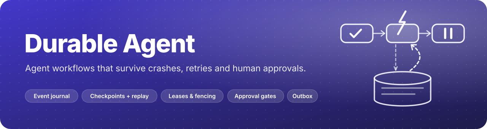
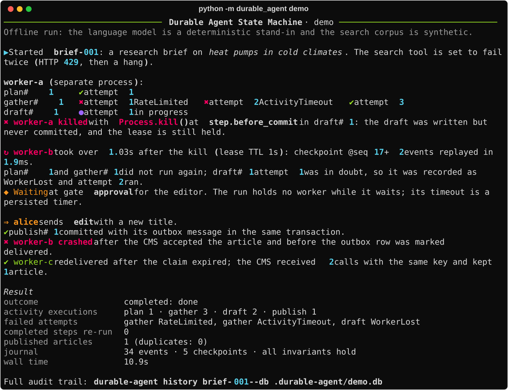
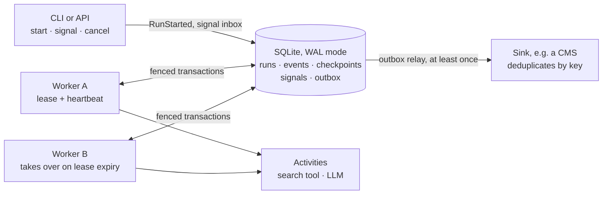
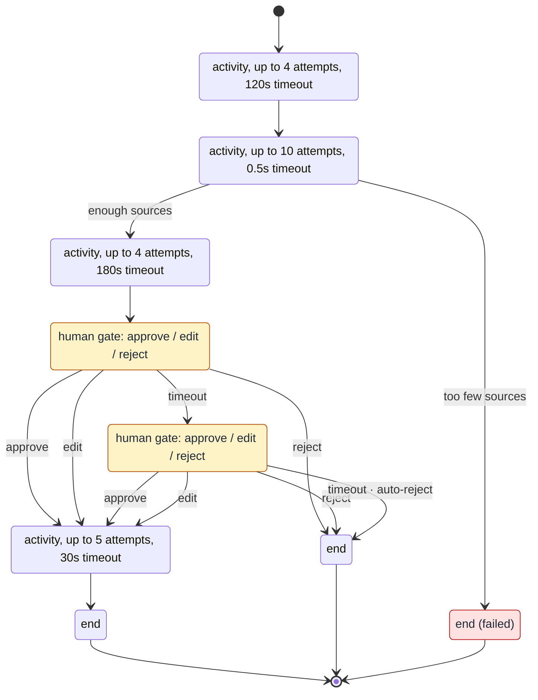
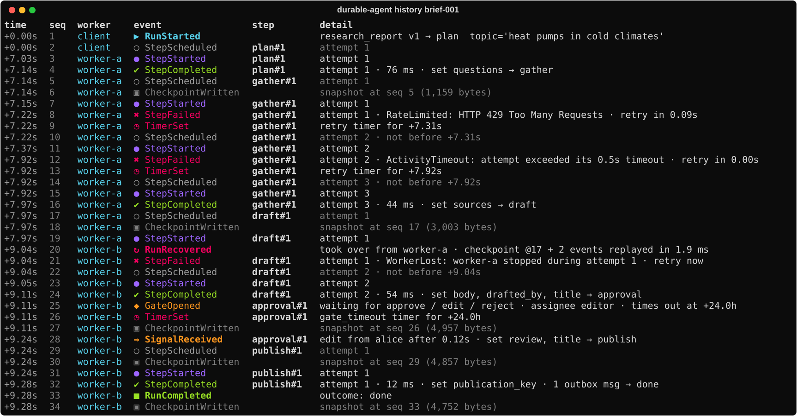
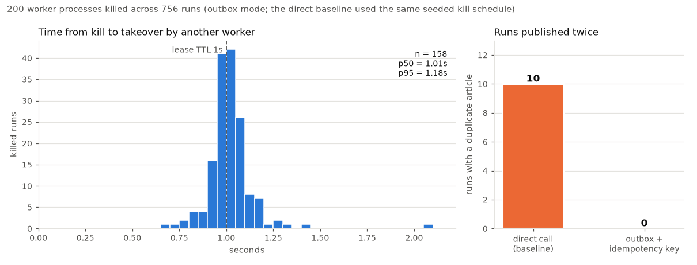
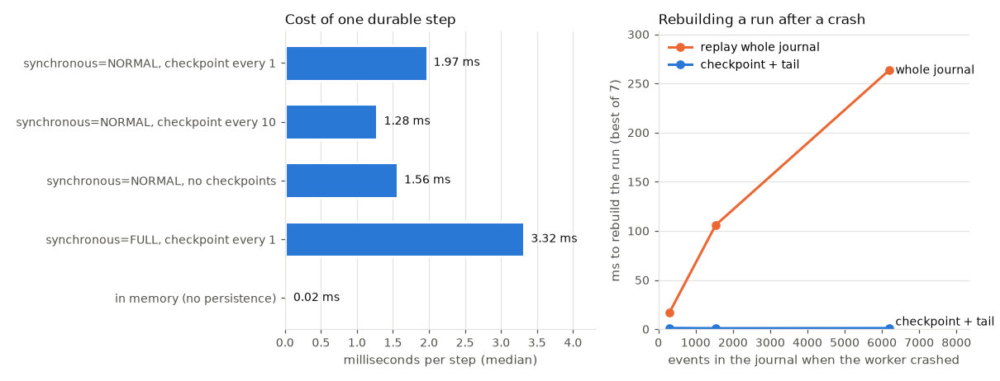

<p align="center">
  
</p>

<p align="center">
  <a href="https://github.com/iamsammy-ak/durable-agent-state-machine/actions/workflows/ci.yml"></a>
  
  
  
  <a href="LICENSE"></a>
</p>

**Durable Agent State Machine** is a small durable-execution runtime for agent workflows, in the spirit of
Temporal but in a single Python package backed by one SQLite file. A workflow is a typed state machine; every step
is recorded in an append-only event journal, so a run survives a killed worker, retries flaky tools with
exponential backoff, waits days for a human approval, and publishes its result exactly once.

It is tested by killing worker processes for real: 200 `Process.kill()` calls across 756 runs lost no run, broke
no journal invariant and produced no duplicate side effect, while the same kill schedule produced 10 duplicate
publications when the side effect was called directly.



## Why this exists

An agent that researches, drafts and publishes is a long-running process with three kinds of failure that a
`for` loop around an LLM call does not survive:

- **Crashes.** A deploy, an out-of-memory kill or a laptop lid closing loses everything held in memory. Rerunning
  from the start repeats expensive model calls and, worse, side effects: the article goes out twice.
- **Flaky dependencies.** Search APIs time out, rate-limit and return 503s. Retrying in a tight loop makes outages
  worse; giving up loses the work done so far.
- **People.** "A human approves before we publish" means waiting minutes or days. No process should sit in memory
  for that, and the decision (who approved, what they edited) needs an audit trail.

Durable execution solves all three by making the *journal* the source of truth: a run is whatever its recorded
events say, and any worker can pick it up from there.

## Features

| | |
|---|---|
| 🧭 **Typed state machine** | States (activity, human gate, durable timer, terminal), guarded transitions, a Pydantic state model, validation and a generated Mermaid diagram |
| 📜 **Append-only journal** | SQLite in WAL mode; 14 event types; SQL triggers reject any `UPDATE` or `DELETE` of an event |
| 💾 **Checkpoints + replay** | A snapshot plus journal position; resume = load snapshot, fold later events. Completed steps never run again |
| 🔁 **Retry policies** | Exponential backoff with full jitter, max attempts, max interval, non-retryable exception types, per-attempt timeouts |
| 🪪 **Leases with fencing** | Heartbeats keep a worker's lease alive; when it dies another takes over, and a stale worker's writes are refused |
| ✋ **Human-in-the-loop gates** | Approve / edit (with payload) / reject, timeout with escalation, buffered signals, full audit history |
| ⏰ **Durable timers** | Retry backoffs, gate timeouts and sleeps are persisted wake-up times, not in-memory sleeps |
| 📤 **Transactional outbox** | Side effects commit with the step and carry a deterministic idempotency key: effectively-once delivery |
| 💥 **Fault injection** | Seven named crash points plus a chaos harness that kills worker subprocesses at seeded points |
| 🖥️ **CLI** | `demo`, `run`, `worker`, `status`, `history` (Rich timeline), `approve`, `reject`, `resume`, `cancel`, `diagram` |

## How it works



1. **Start.** `engine.start()` validates the input against the state model and writes `RunStarted` and the first
   `StepScheduled` in one transaction.
2. **Claim.** A worker leases a ready run (`BEGIN IMMEDIATE`, lease epoch + 1) and rebuilds it: latest checkpoint
   plus the events after it. A background thread renews the lease every TTL / 3.
3. **Execute.** For an activity it commits `StepStarted`, calls the function (in a helper thread when it has a
   timeout) and commits `StepCompleted` with the result, the chosen transition, the next state's entry events, any
   outbox messages and, by policy, a checkpoint: **all in one transaction**. Every write first checks the lease
   epoch, so a worker that stalled past its lease gets `LeaseLost` instead of writing.
4. **Fail and retry.** A failed attempt commits `StepFailed` with the delay drawn from the retry policy, a `TimerSet`
   and the next `StepScheduled`. The worker then releases the run until the persisted wake-up time.
5. **Wait for a person.** Entering a gate commits `GateOpened` and a timeout timer, then the worker releases the run:
   nothing holds memory while a person decides. `approve`, `edit` or `reject` lands in the signal inbox; a signal is
   consumed in the same transaction that records `SignalReceived` and takes the transition.
6. **Recover.** If a worker dies, its lease expires and another worker claims the run, records `RunRecovered`, and
   marks the interrupted attempt `StepFailed(WorkerLost)` before running a new one. Steps that had completed are
   never executed again.
7. **Deliver.** The outbox relay delivers committed messages and marks them delivered. A crash in between leads to a
   redelivery with the same key, which the sink ignores.

### The example workflow

The research-report agent, as generated by `durable-agent diagram` from the definition in
[`research/workflow.py`](src/durable_agent/research/workflow.py):



`plan` and `draft` call a language model: OpenRouter when `OPENROUTER_API_KEY` is set, otherwise a deterministic
**offline stand-in** that builds questions from templates and drafts by extracting sentences from the sources.
`gather` calls a deliberately flaky search tool over a small **synthetic corpus** (24 notes written for this
repository) with injected timeouts, HTTP 429s and 503s. `publish` sends the approved brief to a stand-in CMS through
the outbox. An unanswered approval escalates; an unanswered escalation is rejected, so nothing is published
without a decision.

### The audit trail

`durable-agent history` prints the journal. This is the demo run: worker-a planned, retried the search twice and
was killed while drafting; worker-b took over from the checkpoint, re-ran only the interrupted draft, waited at
the gate, applied alice's edit and published.



### Delivery semantics, precisely

| What | Guarantee | Why |
|---|---|---|
| State transitions (`StepCompleted`, `SignalReceived`, `TimerFired`) | **Exactly once** | One fenced transaction each; the journal's primary key `(run_id, seq)` and the lease epoch make a second commit impossible |
| Activity code | **At least once** | Re-executed only when a worker dies, is fenced off or times out between `StepStarted` and the commit of the outcome; never after `StepCompleted` |
| Side effects through the outbox | **Effectively once** | The message commits atomically with the step; delivery is at least once; the receiver deduplicates by the key `<run>/<state>#<visit>/<n>` |
| Side effects called directly from an activity | At least once | Unless the external API accepts `ctx.idempotency_key` (stable across attempts and workers) |
| Signals | Consumed exactly once | Marked consumed in the transaction that records `SignalReceived` |
| Timers | Never early; fired by the first worker poll after the wake-up time (plus up to one lease TTL if the run's worker died) | The wake-up time is persisted when the timer is set, not recomputed on resume |
| Durability | Survives process crashes | WAL with `synchronous=NORMAL`; a power cut can lose the last commits (never corrupt the file). `synchronous=FULL` survives power loss at about 1.4 ms extra per step |

## Benchmarks

### Chaos: 200 real process kills

[`benchmarks/chaos_bench.py`](benchmarks/chaos_bench.py) runs research workflows on 8 worker subprocesses that
receive kill plans plus 1 standby worker. Each planned worker dies at a seeded crash point (it prints a marker and
the harness calls `Process.kill()`) or at a random time after start-up, which can be in the middle of a SQLite
transaction. Dead workers are replaced until 200 kills have happened. A seeded approver approves (70%), edits (15%),
rejects (10%) or ignores (5%) each run; the search tool fails 30% of attempts. Then every run is checked against its
expected outcome, the CMS against the journal, and every journal against the invariants in
[`verify.py`](src/durable_agent/verify.py).

| Metric | Outbox (as designed) | Direct call (baseline) |
|---|---:|---:|
| Runs | 756 | 926 |
| Worker processes killed (crash point / random time / unfired plan) | 200 (136 / 54 / 10) | 196 (122 / 54 / 20) |
| Kills that interrupted a leased run | 163 | 170 |
| Runs ending as their decision implies | **756 / 756 (100%)** | 926 / 926 (100%) |
| **Runs published twice** | **0** | **10** |
| Approved runs never published · CMS content differing from journal | 0 · 0 | 0 · 0 |
| Redeliveries absorbed by the idempotency key | 19 | n/a |
| Journal invariant violations · completed steps executed again | 0 · 0 | 0 · 0 |
| Interrupted attempts re-run (`WorkerLost`) | 89 | 94 |
| Recovery time p50 / p95 / max (lease TTL 1 s) | 1.01 / 1.18 / 2.07 s | 0.99 / 1.03 / 1.08 s |
| State rebuild on takeover, p50 | 1.2 ms | 1.0 ms |



The baseline is the same workflow with one change: the publish activity calls the CMS itself with a fresh request id
per attempt, as naive agent code does. A kill after the CMS call and before the step commits makes the retry
publish a second copy. Recovery time is dominated by the lease TTL, which is a setting: a shorter TTL recovers
faster but risks taking over from a worker that is only slow.

### Persistence overhead

[`benchmarks/overhead.py`](benchmarks/overhead.py) runs a 300-step loop whose state carries about 1 KB of text, with
the four configurations interleaved over 7 repeats, and compares it with the same logic in memory.

| Configuration | ms per step, median | ms per step, best |
|---|---:|---:|
| `synchronous=NORMAL`, checkpoint every transition | 1.97 | 1.19 |
| `synchronous=NORMAL`, checkpoint every 10 | 1.28 | 0.89 |
| `synchronous=NORMAL`, no checkpoints | 1.56 | 0.87 |
| `synchronous=FULL`, checkpoint every transition | 3.32 | 2.64 |
| in memory, no persistence | 0.03 | - |

| Journal length when the worker crashed | Full replay (best of 7) | Checkpoint + 19-event tail (best of 7) |
|---:|---:|---:|
| 296 events | 16.9 ms | 1.2 ms |
| 1,536 events | 105.9 ms | 0.9 ms |
| 6,186 events | 263.2 ms | 1.1 ms |



A durable step costs about 1-2 ms, two SQLite commits, which is negligible next to a model call that takes seconds.
Checkpoints keep recovery constant-time however long a run has been going.

**Reproduce:**

```bash
PYTHONPATH=src python benchmarks/chaos_bench.py --runs 200 --crashes 200 --workers 8 --seed 7 --lease-ttl 1
PYTHONPATH=src python benchmarks/overhead.py
```

Results, with every kill logged, are in [`benchmarks/results/`](benchmarks/results/) as JSON and Markdown.
**Data and assumptions:** everything runs offline (stand-in LLM, synthetic corpus, simulated 50 ms search latency).
Measured on one Windows 11 laptop (Python 3.13, SQLite 3.45, 12 logical CPUs) that was running other heavy jobs at
the same time, so absolute timings are noisy: read them as orders of magnitude and compare rows, not machines. The
number of runs is not fixed: runs are admitted two per worker until both 200 runs and all 200 kill plans are used.

## Quick start

```bash
git clone https://github.com/iamsammy-ak/durable-agent-state-machine.git
cd durable-agent-state-machine
python -m venv .venv
source .venv/bin/activate        # Windows: .venv\Scripts\activate
pip install -e ".[dev]"
durable-agent demo               # or: python -m durable_agent demo
```

Then crash a run yourself and bring it back:

```bash
durable-agent run "solid-state batteries" --run-id brief-002 --fail-first rate_limit,timeout \
    --crash-at step.before_commit@draft        # the process dies mid-draft (exit code 137)
durable-agent status                           # brief-002 is still leased by the dead process
durable-agent resume brief-002                 # waits for the lease, replays, stops at the approval gate
durable-agent approve brief-002 --by alice --title "Solid-state batteries: where they stand"
durable-agent history brief-002
```

Start long-running workers with `durable-agent worker` (as many as you like, on the same database). A live language
model is optional: copy `.env.example` to `.env` and set a free key from [openrouter.ai/keys](https://openrouter.ai/keys).

| Variable | Purpose |
|---|---|
| `OPENROUTER_API_KEY` | Enables a real model for `plan` and `draft` (offline stand-in otherwise) |
| `OPENROUTER_MODELS` | Optional comma-separated model list, tried in order |
| `DURABLE_AGENT_DB` | Default database path for the CLI (`.durable-agent/runs.db`) |
| `DURABLE_AGENT_OFFLINE` | `1` forces the offline stand-in even when a key is set |

## Use it as a library

```python
from pydantic import BaseModel

from durable_agent import ActivityContext, Engine, RetryPolicy, Workflow


class Ticket(BaseModel):
    text: str
    category: str | None = None
    reply: str | None = None


class Approve(BaseModel):
    note: str = ""


wf = Workflow("triage", Ticket, start="classify")


@wf.activity("classify", retry=RetryPolicy(max_attempts=5, initial_interval=0.5), timeout=30)
def classify(ctx: ActivityContext, t: Ticket) -> dict:
    return {"category": "billing" if "invoice" in t.text.lower() else "general"}  # an LLM call in real life


@wf.activity("send_reply")
def send_reply(ctx: ActivityContext, t: Ticket) -> dict:
    ctx.outbox.send("email", {"body": f"About your {t.category} question..."})  # committed with the step
    return {"reply": "queued"}


wf.gate("review", signals={"approve": Approve}, timeout=3600)
wf.terminal("done")
wf.terminal("expired")
wf.transition("classify", "review", guard=lambda t: t.category == "billing", label="billing")
wf.transition("classify", "send_reply")
wf.transition("review", "send_reply", on="approve")
wf.transition("review", "expired", on="timeout")
wf.transition("send_reply", "done")


class EmailSink:
    def deliver(self, key: str, payload: dict) -> None:  # must be idempotent by key
        print("send once:", key)


engine = Engine("triage.db", [wf], sinks={"email": EmailSink()})
run_id = engine.start("triage", {"text": "My invoice is wrong"})
engine.drain()  # classify, then park at the review gate
print(engine.run(run_id).status, engine.run(run_id).waiting_on)
engine.signal(run_id, "approve", {"note": "refund ok"}, sender="lead")
engine.drain()  # resume, reply through the outbox
print(engine.run(run_id).status, engine.state(run_id).data["reply"])
```

```text
RunStatus.WAITING signal:review
send once: run-ddc21d8454/send_reply#1/0
RunStatus.COMPLETED queued
```

`engine.drain()` processes work in the calling thread; in production run `durable-agent worker` processes (or
`engine.worker().run()` threads) against the same file. [`examples/approval_workflow.py`](examples/approval_workflow.py)
shows a run that waits for approval across two separate process invocations.

## Design decisions

- **An explicit state machine with recorded transitions, not replayed workflow code.** Temporal re-executes your
  workflow function on recovery, which forces it to be deterministic. Here the journal records each decision
  (`StepCompleted` carries `next`), so replay is a fold over data: guards are never re-evaluated, workflow code has no
  determinism rules, and the definition can be validated and drawn. The cost is expressiveness: loops and branches are
  transitions, not Python control flow.
- **SQLite in WAL mode as the only store.** The journal, the runs index, checkpoints, signals and the outbox live in
  one file, so one local transaction covers all of them: that is what makes the outbox atomic without two-phase
  commit. The alternative, Postgres or a queue plus a database, scales across machines but needs operations work and
  distributed transactions. The cost: all workers share one host's disk.
- **Leases with fencing tokens, not just heartbeats.** A heartbeat tells others a worker is alive; it does not stop a
  worker that froze for longer than its lease from waking up and writing. Every write checks the lease epoch inside
  its transaction, so the stale worker gets `LeaseLost`
  (`test_a_stalled_worker_is_fenced_off_after_another_takes_over`). The cost is recovery latency of up to one TTL.
- **Effectively-once effects through an outbox and idempotent receivers, not "exactly-once execution".** A crash
  between doing something and recording that it was done cannot be closed by any amount of code in one process. The
  outbox moves the side effect after the commit and the key lets the receiver drop repeats. Sinks must therefore
  deduplicate, and delivery is asynchronous to the step.
- **Snapshots hold state, not history.** The first version kept a record of every step in the run state, so each
  checkpoint grew with the run: the overhead benchmark showed checkpointing every transition costing more per step
  the longer the run, and replay from a checkpoint slowing down as the journal grew. Completed steps are now folded
  into the data and dropped from the state (the journal keeps the history), so a snapshot is proportional to the
  workflow's data: about 1-2 ms per step, and checkpoint replay flat at about 1 ms.
- **A lost worker uses up one attempt.** An attempt interrupted by a crash counts towards `max_attempts`, as in
  Temporal, so an activity that crashes its worker every time (a poison input) eventually fails instead of looping
  forever. The cost is that crashes spend the retry budget; in the chaos run no step exhausted it.

## Project structure

```
durable-agent-state-machine/
├── src/durable_agent/
│   ├── workflow.py       states, guarded transitions, validation, Mermaid export
│   ├── events.py         the 14 event types and run statuses
│   ├── state.py          run state as a fold over events; snapshots
│   ├── store.py          SQLite schema, fenced transactions, leases, signals, outbox
│   ├── executor.py       drives one leased run: activities, retries, gates, timers
│   ├── worker.py         claim loop, heartbeats, drive-one-run
│   ├── outbox.py         relay with at-least-once delivery
│   ├── retry.py          backoff with full jitter, error classification
│   ├── engine.py         public API: start, signal, cancel, state, history
│   ├── verify.py         journal and checkpoint invariants
│   ├── crash.py          named crash points (fault injection)
│   ├── supervisor.py     worker subprocesses with real kills
│   ├── chaos.py          chaos harness used by the tests and the benchmark
│   ├── llm.py · config.py  OpenRouter client (fallback, cache, JSON repair)
│   ├── render.py         Rich timeline, tables and panels
│   ├── demo.py · cli.py · worker_main.py
│   └── research/         the example agent: workflow, tools, corpus, offline stand-in
├── tests/                78 tests: unit, property-based, crash recovery, CLI, real process kills
├── benchmarks/           chaos_bench.py, overhead.py and results/
├── examples/             approval_workflow.py
├── scripts/              render_assets.py (terminal screenshots)
└── assets/               banner, terminal SVGs, charts
```

## Testing

```bash
pytest -q          # 78 tests, under a minute on a laptop
ruff check . && mypy
```

The suite covers retry bounds and monotonicity with Hypothesis; workflow validation; replay equivalence from every
checkpoint; the append-only triggers; lease hand-over and fencing; the lost-wake-up race between a signal and a
parking worker; timeouts that abandon an attempt; durable sleeps across a worker restart; a crash at every step
boundary; a property test that a run with any single crash ends in the same state as one without; the
duplicate that a direct call produces and the outbox prevents; the CLI end to end; and two tests that kill real
worker subprocesses (a small version of the chaos benchmark, and the demo).

## Limitations

- **One machine.** Workers coordinate through one SQLite file, so they must share a local disk; network file systems
  do not give SQLite reliable locks. Write throughput is bounded by one SQLite writer.
- **Wall-clock time.** Leases and timers compare `time.time()` values, which assumes workers' clocks agree (trivially
  true on one machine).
- **Timed-out attempts are abandoned, not stopped.** Python cannot kill a thread; the activity receives
  `ctx.cancelled` and should check it. Its late result is discarded.
- **No workflow versioning API.** In-flight runs replay recorded transitions, so changed guards are safe, but renaming
  states or changing the state model needs a manual migration; an incompatible snapshot falls back to a full replay.
- **One step at a time per run.** No parallel branches or child workflows yet; workers poll rather than being pushed.
- **The example is a stand-in.** Without a key the LLM is a deterministic template/extraction stand-in, the corpus
  is synthetic and the CMS is a local SQLite file; benchmark timings come from one busy laptop.

## Roadmap

- [ ] Parallel branches (fan-out and join) within a run
- [ ] A Postgres store using `SELECT ... FOR UPDATE SKIP LOCKED` for workers on several machines
- [ ] Versioned workflow definitions with migrations for in-flight runs
- [ ] A small web page for approval gates (approve or edit from a browser)

## License

[MIT](LICENSE) © 2026 Abhishek Kumar
